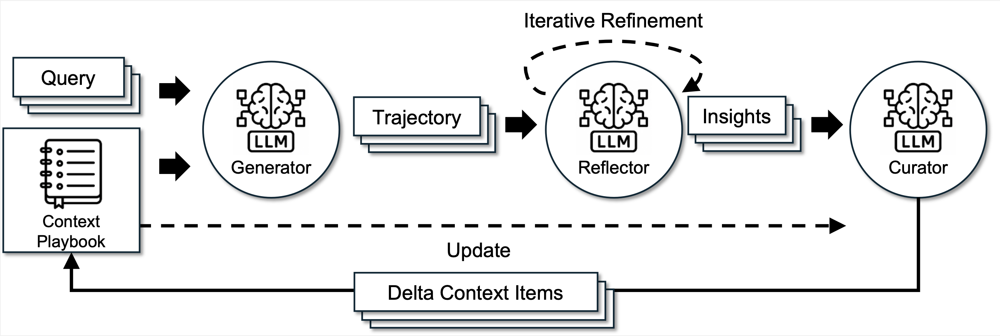

# FTEC5660 ACE Formula Reproduction

This project evaluates **offline ACE with ground-truth training labels on Formula**, as reported in Table 2 of the ICLR 2026 paper. ACE generates an answer, reflects on training feedback, and adds reusable rules to a playbook. The paper-profile runs measure the base LLM, ACE with an empty playbook, and ACE with the playbook selected on the validation split.

[Official ACE repository](https://github.com/ace-agent/ace) · [Paper, Section 4.4 and Table 2](https://arxiv.org/html/2510.04618v3#S4.SS4) · [Formula dataset documentation](https://finlora-docs.readthedocs.io/en/latest/tasks/xbrl_analysis_tasks.html#financial-math)

## Experimental design

| Profile | Train | Validation | Test | Offline epochs |
| --- | ---: | ---: | ---: | ---: |
| `paper` | 500 | 300 | 200 | 5 |
| `paper-subset` | 100 | 50 | 200 | 5 |
| `paper-short` | 24 | 8 | 30 | 2 |
| `pilot` (the original run) | 12 | 8 | 30 | 1 |

The `paper` profile uses every row in the released ACE Formula files in file order. The smaller profiles select rows within each split without replacement using seed `5660`. Within each profile, the baseline and ablation use the same ordered data, model, decoding settings, prompts, and scoring. ACE adapts one training sample at a time, validates at the end of every epoch, and selects the best checkpoint by validation accuracy. Test labels are used for scoring only. The baseline permits up to five corrective reflection rounds per initially incorrect training answer. The ablation changes that cap to one. Correction stops as soon as a regeneration matches the training label.

Paper Table 2 reports **67.5%** for the base LLM and **85.5%** for offline ACE with training labels on Formula, a gain of **18.0 percentage points**. The baseline phase of the paper profiles separately scores the raw dataset prompts without ACE, following the paper's description of the base LLM. The ACE runs use the released ACE Formula input processing, which extracts the question from the raw prompt. The `paper` profile with `--provider openrouter` requests DeepSeek-V3.1 in non-thinking mode through a pinned SiliconFlow FP8 route. The deployment, validation schedule, and prompt handling can still differ from the paper's run. The default official DeepSeek endpoint uses `deepseek-flash` and constitutes a model substitution.

## Install on Windows PowerShell

Requirements are **Git**, **64-bit Python 3.12**, internet access, and a key for the selected API provider. Run commands from the extracted `ace-formula-reproduction` directory. On macOS or Linux, use `python3.12` in place of `py -3.12` and `.venv/bin/python` in place of `.\.venv\Scripts\python.exe`.

```powershell
py -3.12 -m venv .venv
.\.venv\Scripts\python.exe -m pip install -r experiments/requirements-formula.txt
Copy-Item .env.example .env
notepad .env
```

Set `OPENROUTER_API_KEY` in `.env` for the DeepSeek-V3.1 route, or set `DEEPSEEK_API_KEY` for the official DeepSeek API. Git ignores `.env`. The default API endpoint is `https://api.deepseek.com` and the default model ID is `deepseek-flash`. For a compatible endpoint you control, set `DEEPSEEK_BASE_URL` in `.env` and use `--model` if needed. The first import of `tiktoken` may download its public `cl100k_base` vocabulary. The optional embedding analyzer is disabled and the experiment requires no GPU or local model.

[DeepSeek API documentation](https://api-docs.deepseek.com/)

## Run one short comparison with a DeepSeek key

```powershell
# Optional API check with one plain-text and one JSON request.
.\.venv\Scripts\python.exe -X utf8 -m experiments.formula --profile paper-short --provider deepseek --verify-api

# Run the base LLM, then five-round ACE, then one-round ACE.
.\.venv\Scripts\python.exe -X utf8 -m experiments.formula --profile paper-short --provider deepseek
```

The short profile estimates 15–20 minutes for one trial per condition at the speed observed in earlier small runs. It requires at least 566 model calls, with additional calls for corrective rounds and retries. API latency and the length of the playbook can extend the run. Results go to `results/formula-paper-short-deepseek/`. Run the same command again to resume after an interruption. To inspect the baseline before running the ablation, append `--phase baseline` to the second command, then repeat it with `--phase ablation`.

Report this as a small-sample replication with a substituted model, two epochs, and one trial per condition. One correct answer is worth 3.33 percentage points on the 30-item test set. `sample_variance` is blank because one trial cannot estimate run-to-run variance.

## Run the paper-profile experiments

```powershell
# Inspect the pinned configuration and data without a key.
.\.venv\Scripts\python.exe -X utf8 -m experiments.formula --profile paper --provider openrouter --plan-only

# Confirm that the endpoint returns both plain text and JSON.
.\.venv\Scripts\python.exe -X utf8 -m experiments.formula --profile paper --provider openrouter --verify-api

# Collect the three five-round baseline trials first.
.\.venv\Scripts\python.exe -X utf8 -m experiments.formula --profile paper --provider openrouter --phase baseline

# Reuse the saved baseline and run three one-round trials with the same settings.
.\.venv\Scripts\python.exe -X utf8 -m experiments.formula --profile paper --provider openrouter --phase ablation
```

For a smaller run with the same V3.1 route, replace `--profile paper` with `--profile paper-subset` in each command. With an official DeepSeek key only, use `--profile paper-subset --provider deepseek` throughout and report the model substitution. Each profile and provider has a separate results folder. The full baseline makes at least 12,100 model calls per trial, and the subset baseline at least 2,850. These lower bounds include the base LLM and exclude corrective rounds and retries. Keep the profile fixed from baseline through ablation and retain all completed trials, including runs with negative gains.

## Run the pilot

```powershell
# Inspect the settings and fixed sample indices without sending an API request.
.\.venv\Scripts\python.exe -X utf8 -m experiments.formula --plan-only

# Check the full pipeline with 2 train, 2 validation and 3 test questions per condition.
.\.venv\Scripts\python.exe -X utf8 -m experiments.formula --quick

# Repeat the original pilot with three repetitions per condition.
.\.venv\Scripts\python.exe -X utf8 -m experiments.formula
```

`--trials 4` or `--trials 5` is supported. The default request uses non-thinking mode, temperature `0`, top-p `1`, and up to `4096` output tokens. The seed controls row selection. Hosted model responses may vary across trials. `--workers 1` lowers concurrent evaluation calls if the API returns HTTP 429. HTTP 401 usually indicates a missing or invalid key, and HTTP 402 indicates an account balance issue.

Repeat the same command to resume after an interruption. The runner reuses completed trials and completed base LLM evaluations. It starts a fresh ACE attempt for an unfinished trial. Choose a new `--output` directory if settings change, and pass the same directory to the baseline and ablation phases. When a response reaches the output limit, the runner retries at `8192` and, if needed, `16384` output tokens. The runner refreshes the CSV files after each validated trial. Use the `n` column to check how many trials are included.

## Outputs and report

The paper profiles write to `results/formula-paper-<provider>/`, `results/formula-paper-subset-<provider>/`, or `results/formula-paper-short-<provider>/`. The pilot writes to `results/formula-study/` and the smoke run writes to `results/formula-smoke/`.

| File | Use |
| --- | --- |
| `study_config.json` | Model, API endpoint, decoding parameters, train/validation/test indices and hashes |
| `trials.csv` | Per-run initial and final accuracy, validation accuracy, reflection retries, wall time, completed API calls and token usage |
| `summary.csv` | Mean and sample variance for each condition and the paired differences |
| `base_llm.json` | Per-item plain-text predictions and exact-match outcomes for each paper-profile baseline trial |
| `paired_differences.csv` | One-round minus five-round metrics for completed trial pairs |
| `final_results.json`, `final_test_results.json`, `best_playbook.txt` | Raw ACE metrics, errors, and the selected playbook under each attempt directory |

Compare `base_llm_accuracy_pct` with `final_accuracy_pct` for the Table 2 comparison. `ace_minus_base_llm_pp` records that gain. `accuracy_gain_pp` records the separate within-ACE comparison against an empty playbook. Report the trial count, mean, and sample variance. The paired difference compares one-round and five-round ACE. Its API calls, tokens, and wall time cover ACE only, including logged truncation retries in the completed attempt. Base LLM calls are recorded separately. SDK transport retries contribute to wall time without a corresponding logged model reply. Smoke and mock runs are setup checks. Live scores must come from the selected API.

## Code and Git history

- `utils.py` and `llm.py` configure the API route for both conditions.
- `experiments/formula.py` selects data, evaluates the base LLM, runs offline ACE, and exports the comparisons. The experimental change is in `CONDITIONS`, which passes the five-round or one-round cap to the training loop through `max_num_rounds`.
- `eval/finance/data/` contains the released benchmark files.

The extracted checkout includes Git history. On GitHub, create an empty public repository. Then replace the placeholder in the URL below and push the existing commits. The extracted checkout uses `upstream` for the authors' repository.

```powershell
git log -4 --oneline
git remote -v
git remote add origin https://github.com/YOUR_USERNAME/YOUR_REPO.git
git push -u origin main
```

If including experiment evidence in the repository, copy the completed formal CSV summaries into an `evidence/` folder and commit that folder. The raw `results/` directory and `.env` are ignored. The course submission also requires the report of up to 10 pages and the Zoom recording of up to 15 minutes.

---

# Original upstream README

# Agentic Context Engineering: Evolving Contexts for Self-Improving Language Models

<div align="left">

<p align="left" style="display:flex; gap:18px;">
  <a href="https://arxiv.org/abs/2510.04618" target="_blank" style="margin-right:0;">
    
  </a>
  <a href="https://join.slack.com/t/ace-agent/shared_invite/zt-3np7gusuf-DCUJaBshNjuAz5ECDx702w" target="_blank" style="margin-right:0;">
    
  </a>
  <a href="https://discord.gg/NW2W4xYt" target="_blank" style="margin-right:0;">
    
  </a>
  <a href="https://deepwiki.com/ace-agent/ace" target="_blank" style="margin-right:0;">
    
  </a>
  <a href="https://forms.gle/ZNJpqVBRa8QoPjzM7" target="_blank" style="margin-right:0;">
    
  </a>
</p>




</div>

---

## 🎯 Overview

ACE (Agentic Context Engineering) is a framework that enables large language models to self-improve by treating contexts as evolving playbooks that accumulate, refine, and organize strategies through a modular process of generation, reflection, and curation. Unlike traditional approaches that suffer from **brevity bias** and **context collapse**, ACE introduces structured, incremental updates guided by a grow-and-refine principle, preserving detailed, domain-specific knowledge while remaining comprehensive and scalable throughout adaptation.

## Latest News
- **2025 Nov**: ACE [Paper](https://arxiv.org/abs/2510.04618) and Repo says "Hello World"!

### Key Features

- 🔄 **Three-Role Agentic Architecture**: Generator, Reflector, and Curator work together to continuously improve contexts
- 📈 **Incremental Delta Updates**: Localized edits that preserve prior knowledge while accumulating new insights
- 🎓 **Self-Supervised Learning**: Adapts effectively without labeled supervision by leveraging natural execution feedback
- 🚀 **High Efficiency**: 86.9% lower adaptation latency on average compared to existing adaptive methods
- 💰 **Cost Effective**: Significantly fewer rollouts and lower dollar costs while achieving higher accuracy

### Tutorials
- 📚 **Adding Dataset for Evaluation** [Link](tutorials/ExtendingDatasets.md)
- ✨ **Extending ACE for Tool Calling** (Coming Soon) 

### 📊 Performance

ACE consistently outperforms strong baselines, achieving average gains of **+10.6%** on agent tasks and **+8.6%** on domain-specific benchmarks, across both offline and online adaptation settings.

#### Benchmarks

| Task Category | Dataset | Improvement | Details |
|---------------|---------|-------------|---------|
| **Agent Tasks** | AppWorld | +10.6% | Matches top-ranked production-level agent (GPT-4.1) on average and surpasses it on harder test-challenge split, using smaller open-source model |
| **Finance** | FiNER + XBRL Formula | +8.6% | Domain-specific reasoning with structured information extraction |

#### Efficiency Improvements

- **Offline (AppWorld)**: -82.3% latency and -75.1% rollouts vs GEPA
- **Online (FiNER)**: -91.5% latency and -83.6% token cost vs Dynamic Cheatsheet


#### How It Works

1. **Generator** produces reasoning trajectories for new queries, surfacing both effective strategies and recurring pitfalls
2. **Reflector** separates evaluation and insight extraction from curation, improving context quality
3. **Curator** converts lessons into structured delta updates with helpful/harmful counters, using deterministic merging with de-duplication and pruning

This design prevents the **context collapse** problem where iterative rewriting erodes details over time.

## 🚀 Quick Start

### Installation

```bash
# Clone the repository
git clone https://github.com/ace-agent/ace.git
cd ace

# Install uv (if not already installed)
curl -LsSf https://astral.sh/uv/install.sh | sh

# Install ACE and core dependencies
uv sync

# Set up API keys
cp .env.example .env
# Edit .env and set the API key(s) you need
```

### Basic Usage

```python
from ace import ACE
from utils import initialize_clients

# Initialize API clients
api_provider = "sambanova" # or "together", "openai", "commonstack"

# Initialize ACE system
ace_system = ACE(
    api_provider=api_provider,
    generator_model="DeepSeek-V3.1",
    reflector_model="DeepSeek-V3.1",
    curator_model="DeepSeek-V3.1",
    max_tokens=4096
)

# Prepare configuration
config = {
    'num_epochs': 1,
    'max_num_rounds': 3,
    'curator_frequency': 1,
    'eval_steps': 100,
    'online_eval_frequency': 15,
    'save_steps': 50,
    'playbook_token_budget': 80000,
    'task_name': 'your_task',
    'json_mode': False,
    'no_ground_truth': False,
    'save_dir': './results',
    'test_workers': 20,
    'use_bulletpoint_analyzer': false,
    'api_provider': api_provider

}

# Offline adaptation
results = ace_system.run(
    mode='offline',
    train_samples=train_data,
    val_samples=val_data,
    test_samples=test_data,  # Optional
    data_processor=processor,
    config=config
)

# Online adaptation
results = ace_system.run(
    mode='online',
    test_samples=test_data,
    data_processor=processor,
    config=config
)

# Evaluation only
results = ace_system.run(
    mode='eval_only',
    test_samples=test_data,
    data_processor=processor,
    config=config
)
```

## 💼 Finance Domain Example

### Training Script Usage

The `finance/run.py` script provides a unified interface for training and evaluation on financial analysis tasks.

```bash
# Offline training (with automatic initial and final testing)
uv run python -m eval.finance.run \
    --task_name finer \
    --mode offline \
    --save_path results

# Online training and testing
uv run python -m eval.finance.run \
    --task_name finer \
    --mode online \
    --save_path results

# Run evaluation on the test split only. Provide a pre-trained playbook or leave initial_playbook_path empty to evaluate an uninitialized playbook.
uv run python -m eval.finance.run \
    --task_name finer \
    --mode eval_only \
    --initial_playbook_path results/ace_run_TIMESTAMP_finer_offline/best_playbook.txt \
    --save_path test_results

# Training with custom configuration
uv run python -m eval.finance.run \
    --task_name finer \
    --mode offline \
    --save_path results \
    --num_epochs 3 \
    --eval_steps 100 \
    --max_tokens 4096
```

#### Available Arguments
<details>
<summary>Click here to see available arguments</summary>

| Argument | Description | Default |
|----------|-------------|---------|
| `--task_name` | Task to train on (e.g., `finer`, `formula`) | Required |
| `--save_path` | Directory to save results | Required |
| `--initial_playbook_path` | Path to initial playbook | Optional |
| `--mode` | Run mode: 'offline' for offline training with validation, 'online' for online training and testing on test split, 'eval_only' for evaluation only | `offline` |
| `--api_provider` | API provider for LLM calls. Choose from ['sambanova', 'together', 'openai', 'commonstack'] | `sambanova` |
| `--num_epochs` | Number of training epochs | 1 |
| `--max_num_rounds` | Max reflection rounds for incorrect answers | 3 |
| `--curator_frequency` | Run curator every N steps | 1 |
| `--eval_steps` | Evaluate every N steps | 100 |
| `--online_eval_frequency` | Update playbook every N samples for evaluation in online mode | 15 |
| `--save_steps` | Save intermediate playbooks every N steps | 50 |
| `--max_tokens` | Maximum tokens for LLM responses | 4096 |
| `--playbook_token_budget` | Total token budget for playbook | 80000 |
| `--test_workers` | Number of parallel workers for testing | 20 |
| `--generator_model` | Model for generator | `DeepSeek-V3.1` |
| `--reflector_model` | Model for reflector | `DeepSeek-V3.1` |
| `--curator_model` | Model for curator | `DeepSeek-V3.1` |
| `--json_mode` | Enable JSON mode for structured output | False |
| `--no_ground_truth` | Don't use ground truth in reflection | False |
| `--use_bulletpoint_analyzer` | Enable bulletpoint analyzer for playbook deduplication and merging | False |
| `--bulletpoint_analyzer_threshold` | Similarity threshold for bulletpoint analyzer (0-1) | 0.9 |

</details>

## 📈 Results and Outputs

Using offline training as an example, after training, ACE generates:

```
results/
└── ace_run_TIMESTAMP_finer_offline/
    ├── run_config.json                # Training configuration
    ├── final_results.json             # Consolidated results from all stages
    ├── initial_test_results.json      # Initial test results with empty playbook (baseline)
    ├── final_test_results.json        # Final test results with best playbook
    ├── train_results.json             # Training results
    ├── val_results.json               # Validation results and error logs
    ├── pre_train_post_train_results.json     # Detailed pre-train and post-train generator output for each training sample
    ├── final_playbook.txt             # Final evolved context
    ├── best_playbook.txt              # Best performing context (only for offline training)
    ├── bullet_usage_log.jsonl         # Bullet usage tracking
    ├── curator_operations_diff.jsonl  # Curator operation tracking
    ├── detailed_llm_logs/             # Detailed LLM call logs
    └── intermediate_playbooks/        # Intermediate playbooks 
```

### Understanding Playbook Format

The evolved context (playbook) follows this structure:

```
## STRATEGIES & INSIGHTS
[str-00001] helpful=5 harmful=0 :: Always verify data types before processing
[str-00002] helpful=3 harmful=1 :: Consider edge cases in financial data

## FORMULAS & CALCULATIONS
[cal-00003] helpful=8 harmful=0 :: NPV = Σ(Cash Flow / (1+r)^t)

## COMMON MISTAKES TO AVOID
[mis-00004] helpful=6 harmful=0 :: Don't forget timezone conversions
```

Each bullet has:
- **ID**: `[section_slug-00000]` for tracking
- **Counts**: `helpful=X harmful=Y` updated by Reflector
- **Content**: `:: actual advice or strategy`

<!-- ## 🎓 Key Innovations

### 1. Incremental Delta Updates

Instead of rewriting full prompts, ACE performs delta updates—localized edits that accumulate new insights while preserving prior knowledge.

### 2. Grow-and-Refine Mechanism

A mechanism that balances steady context expansion with redundancy management by merging or pruning context items based on semantic similarity.

### 3. Dedicated Reflector

A specialized Reflector that separates evaluation and insight extraction from curation, improving context quality and downstream performance. -->

### 📬 Supported Tasks
#### Agent Tasks
- **AppWorld**: Simulated digital environment with app interactions
#### Domain-Specific Tasks
- **FiNER**: Financial information extraction
- **XBRL Formula**: Structured financial data processing

## 🛠️ Extending ACE

ACE is designed to be easily extended to new tasks and domains. To add your own task:

1. **Prepare your data**: Create JSONL files with train/val/test splits
2. **Implement DataProcessor**: Only 3 methods needed - `process_task_data()`, `answer_is_correct()`, `evaluate_accuracy()`
3. **Create training script**: Initialize ACE and run training using the `run()` method
4. **Customize prompts** (optional): Adapt prompts to your domain

The evaluation orchestration (parallel test execution, result aggregation) is handled by reusable utilities in `utils.py`, so you only need to focus on task-specific logic.

### Quick Example

```python
class DataProcessor:
    def process_task_data(self, raw_data):
        # Convert your data format to standardized format
        return [{"context": ..., "question": ..., "target": ..., "others": {...}}]
    
    def answer_is_correct(self, predicted, ground_truth):
        # Your comparison logic
        return predicted.strip() == ground_truth.strip()
    
    def evaluate_accuracy(self, predictions, ground_truths):
        # Calculate accuracy
        return sum(self.answer_is_correct(p, g) for p, g in zip(predictions, ground_truths)) / len(predictions)
```
📖 **[Read the full extension guide →](EXTENDING_ACE.md)**


## 🤝 Contributing
We welcome contributions! Please follow these steps:
1. Fork the repository
2. Create a feature branch (`git checkout -b feature/amazing-feature`)
3. Commit your changes (`git commit -m 'Add amazing feature'`)
4. Push to the branch (`git push origin feature/amazing-feature`)
5. Open a Pull Request


## 📚 Additional Resources
- **Blog Posts**: 
  - [Medium: Agentic Context Engineering](https://medium.com/@bingqian/agentic-context-engineering-teaching-language-models-to-learn-from-experience-706c31a872ca)
  - [MarkTechPost Coverage](https://www.marktechpost.com/2025/10/10/agentic-context-engineering-ace-self-improving-llms-via-evolving-contexts-not-fine-tuning/)
  - [InfoQ Article](https://www.infoq.com/news/2025/10/agentic-context-eng/)

### 🙏 Acknowledgments
This work builds upon insights from Dynamic Cheatsheet and incorporates ideas from the broader LLM agent and context optimization research community.

### 📧 Contact
For questions and feedback:
- **Paper Authors**: See [arXiv paper](https://arxiv.org/abs/2510.04618) for author contact information
- **Issues**: Please open an issue on GitHub
- **Discussions**: Join the [GitHub Discussions](../../discussions)

---


## 📝 Citation

If you use ACE in your research, please cite our paper:

```bibtex
@misc{zhang2025agenticcontextengineeringevolving,
      title={Agentic Context Engineering: Evolving Contexts for Self-Improving Language Models}, 
      author={Qizheng Zhang and Changran Hu and Shubhangi Upasani and Boyuan Ma and Fenglu Hong and Vamsidhar Kamanuru and Jay Rainton and Chen Wu and Mengmeng Ji and Hanchen Li and Urmish Thakker and James Zou and Kunle Olukotun},
      year={2025},
      eprint={2510.04618},
      archivePrefix={arXiv},
      primaryClass={cs.LG},
      url={https://arxiv.org/abs/2510.04618}, 
}
```

<div align="center">

**⭐ Star us on GitHub if ACE helps your research!**

Made with ❤️ by the ACE team

</div>
